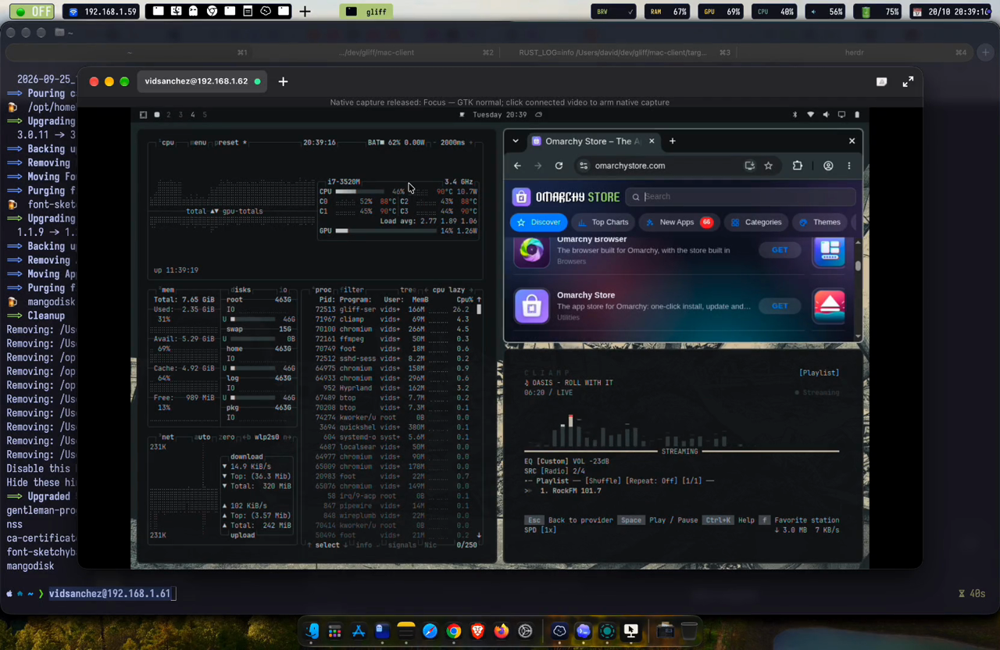

# Gliff for macOS

An **experimental Apple Silicon** client for a Linux/Hyprland desktop over SSH.
This independent adaptation of [Kevin McConnell's original Gliff](https://github.com/omacom/gliff)
(v0.4.0) is not an official upstream release. Install the Linux server separately;
this repository contains only the Mac client.

## Demo

[](docs/media/gliff-demo.mp4)

Click the thumbnail to open the [70-second demo video](docs/media/gliff-demo.mp4)
(MP4, 4.7 MiB).

## Install the app

The **0.1.0-alpha.1 experimental prerelease** targets **Apple Silicon, macOS 15.0+**.
Download `Gliff-0.1.0-alpha.1-arm64.zip`, `SHA256SUMS`, and `build-report.json`
from [its release page](https://github.com/vidsanchez/gliff-macos/releases/tag/v0.1.0-alpha.1).
Intel is unsupported. Check each future artifact's report: its minimum may change.

1. Check the ZIP against `SHA256SUMS` (`shasum -a 256 file.zip`).
2. Extract it and move `Gliff.app` to Applications.
3. The app is **ad-hoc signed**, without Developer ID or notarization. macOS may
   block it. Only if you trust its source, follow Apple's official
   [Privacy & Security → Open Anyway procedure](https://support.apple.com/102445).
   Do not disable Gatekeeper globally.
4. Open Gliff and enter `user@server` in the address bar; previous connections
   are remembered. First prepare SSH in Terminal: keys, agent, host key, and
   `gliff-server` on the Linux host's `PATH`. There is no graphical SSH
   password/passphrase dialog.

The package attempts to include the necessary GTK libraries and resources.
**Operation without Homebrew remains unverified until clean-machine QA passes.**
The downloaded bundle passed user checks for opening, connecting to Linux, video,
typing, and copy/paste on Apple Silicon macOS 27.0.1. This is not a compatibility
matrix or a clean-machine result. The alpha is not stable or production-audited. See the
[release notes](CHANGELOG.md) and [distribution status](docs/distribution.md).

## Homebrew

Install using this repository's Homebrew tap:

```sh
brew tap vidsanchez/gliff-macos https://github.com/vidsanchez/gliff-macos
brew install --cask vidsanchez/gliff-macos/gliff-macos
```

The cask preserves quarantine and macOS security checks; it does not bypass
Gatekeeper. See
[tap maintenance](docs/distribution.md#homebrew).

## Keyboard and privacy

- Command → Linux Super; Option → Alt. `--option-key altgr` enables symbols from
  the Mac layout. A user confirmed Command+C/V in foot/Omarchy after the XKB map
  was fixed to guarantee Insert. That specific test used Hyprland 0.56.2; it is
  not QA of every keyboard/server. The upstream code baseline is 0.4.0, not a
  server-version compatibility matrix.
- **Shift+Esc releases** focus/capture; click the video to regain it.
- System shortcuts remain local by default and **Accessibility is not requested**.
  Native capture requires CLI opt-in: [permissions and limits](docs/security.md).
- Clipboard sharing is enabled by default; `--no-clipboard` disables it.
  Linux→Mac supports only UTF-8 text up to 1 MiB, not images/files. A connected
  host can request advertised Mac clipboard contents. Connect only trusted hosts.
- H.264 Single420 video uses macOS VideoToolbox, without downloading codecs;
  GTK receives BGRA pixels. There is no custom Metal renderer or hardware
  acceleration guarantee. Secure Input, IME/JIS, Fn keys, and protected shortcuts
  are not guaranteed to work.

## Build from source

Requires Apple Silicon macOS, Xcode Command Line Tools, Rust ≥1.92, GTK4 ≥4.14,
libadwaita ≥1.5, and `pkg-config`. Homebrew is one **development** option:

```sh
brew install gtk4 libadwaita pkgconf
cargo build --locked --release -p gliff
./target/release/gliff user@server
```

This does not install or modify the server. Add `--offline` for network-free
builds when dependencies are cached. [Development, tests, and diagnostics](docs/development.md)
· [Packaging and QA](docs/distribution.md) · [Licenses and attribution](ATTRIBUTION.md).
